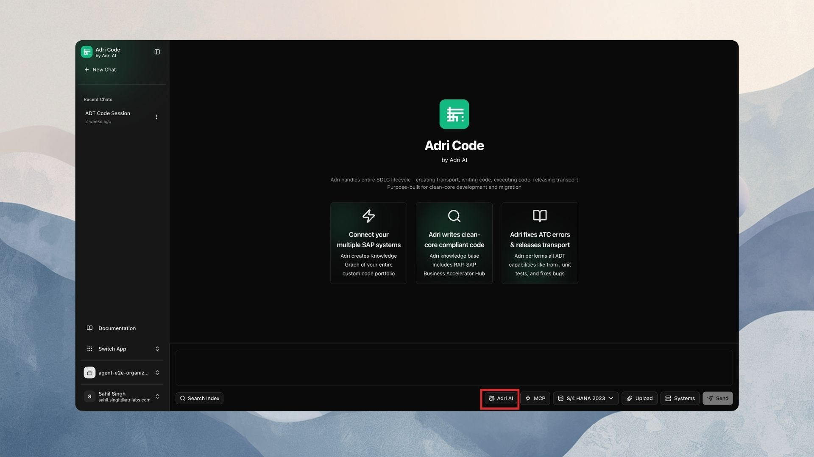
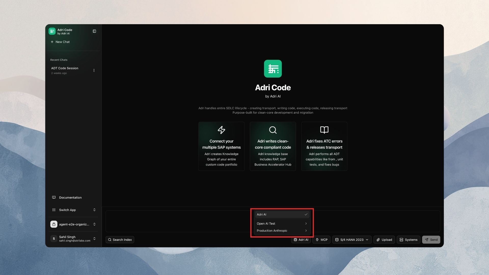
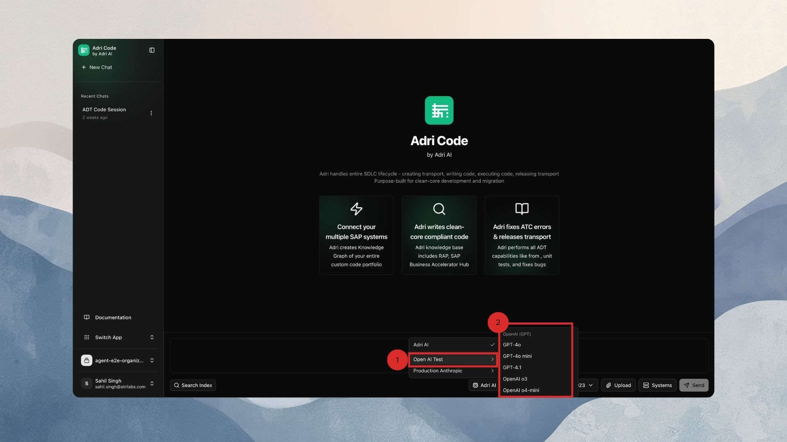
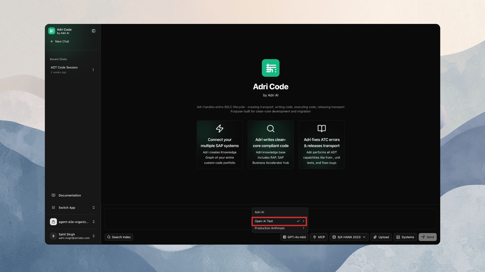

## Pick a model for a conversation (web)

Every conversation can run on its own provider and model. You switch from the **model picker** in the chat composer — no settings page needed.

> In every screenshot, the red box shows exactly where to focus.

### 1. Find the model picker

Open any conversation. At the bottom, next to the message box, there is a button with a CPU icon. By default it reads **Adri AI**.

### 2. Open the picker

Click the button. The dropdown shows:

- **Project default** at the top, only when your project has a default provider — the provider and model new conversations start on.
- **Adri AI** — the Adri-managed lane. Hover it to see **Auto** (Adri's default model) plus one row per managed vendor, such as **Claude** and **OpenAI**, each with its models. A check mark marks the current selection.
- One entry per enabled provider, by the name your team gave it (e.g. `Production Anthropic`).

:::note
If the dropdown says *"No providers configured. Add one in Settings → Providers."*, your project has no providers yet — follow [Add a provider](./add-a-provider.md) first.
:::

### 3. Pick a model

1. Hover over a provider to open its model list.
2. Click the model you want.

You should see a toast like *Switched to Claude Sonnet 4.5*, and the composer button now shows the model's name.

### 4. What the switch means

- The choice applies to **this conversation only**. Other conversations keep their own selection.
- It takes effect on the **next message** you send. Earlier messages are never rewritten.
- The selection is saved — leave and come back, it is still set.

### 5. Pick a managed model

Hover **Adri AI**, then **Claude** or **OpenAI**, and click a model. The toast reads *Switched to Adri AI · GPT-5* and the composer button shows **Adri AI · GPT-5**. The turn runs on Adri's capacity — no API key of yours is involved.

### 6. Go back to the default

Click **Project default** at the top of the picker (toast: *"Using the project default model"*). If your project has no default provider, hover **Adri AI** and click **Auto** instead (toast: *"Using Adri AI (Auto)"*).

## If the button shows "(unavailable)"

The provider behind this conversation's model was removed. Open the picker and choose a new model (**Project default** or **Adri AI → Auto** are the quickest). See [FAQs & troubleshooting](./provider-faqs.md#a-model-shows-unavailable) for details.

## Next steps

- [Switch models in VS Code](./switch-models-vs-code.md)
