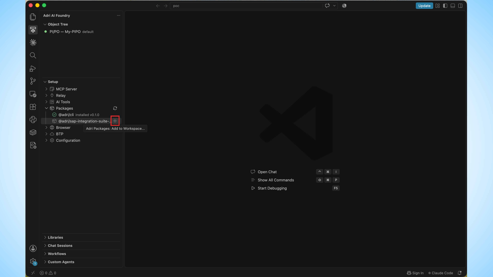
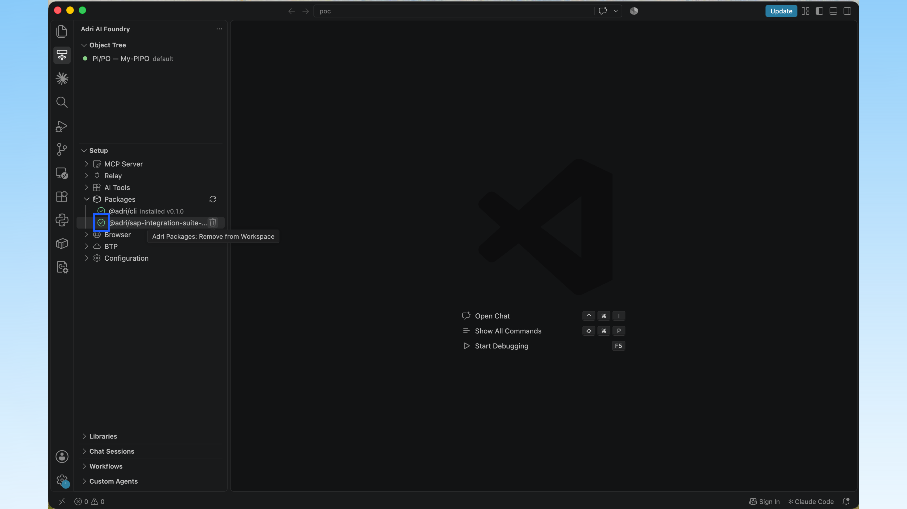

# Add the Integration Suite Toolkit

Before continuing, [request SAP Integration Suite access](./request-access.md), [install Adri AI Foundry for VS Code](../../vs-code-extension/install-vs-code-extension.md), and [sign in to Adri AI](../../vs-code-extension/sign-in-adri-ai.md).

1. Open the workspace you want to use for integration development.
2. In Adri AI Foundry, expand **Setup > Packages**.
3. Select **Add to Workspace** beside the SAP Integration Suite package.

A green check confirms that the package is installed in the workspace.

Next, [connect SAP BTP Cloud Foundry](./connect-cloud-foundry.md).
