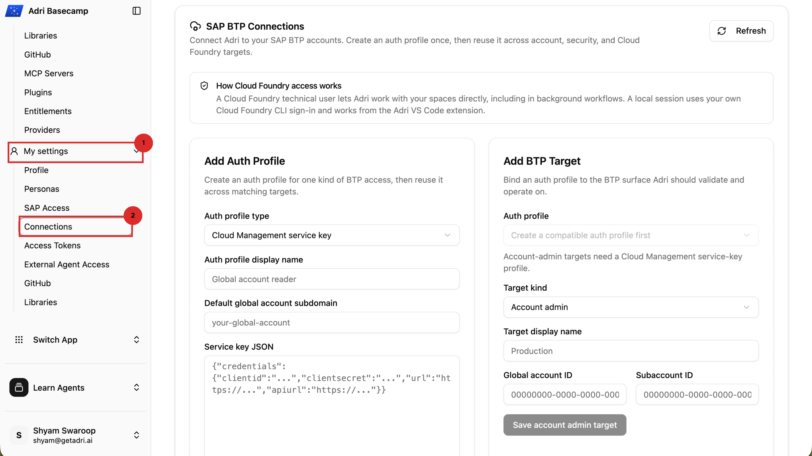
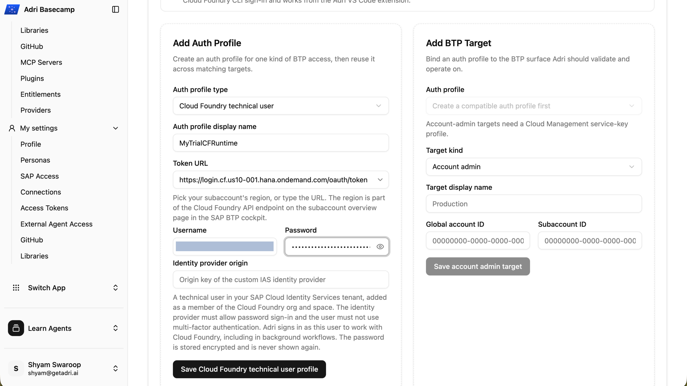
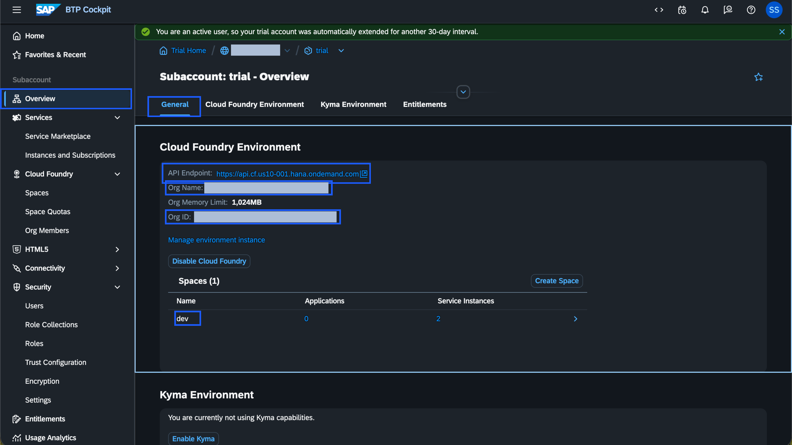
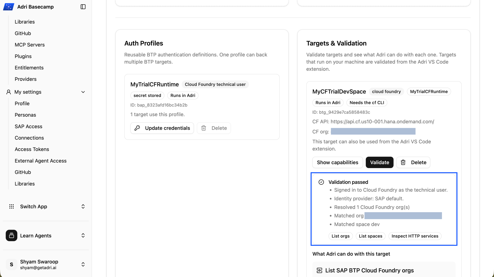
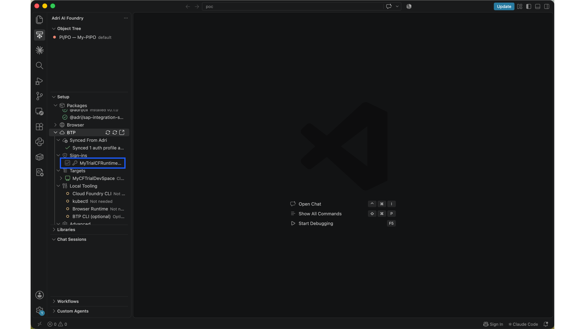

# Connect SAP BTP Cloud Foundry

In Adri Basecamp, open **My settings > Connections** and scroll to **SAP BTP Connections**. Create an authentication profile first, then bind it to a Cloud Foundry target.

## Create an authentication profile

1. Select **Cloud Foundry technical user** as the profile type.
2. Enter a display name.
3. Select or enter the token URL for the subaccount region.
4. Enter the technical user's username and password.
5. Add the identity-provider origin only if you use a custom identity provider.
6. Select **Save Cloud Foundry technical user profile**.

The technical user must support password sign-in and must not require multi-factor authentication. Adri stores its password encrypted and does not display it again.

## Create and validate the target

1. Select the authentication profile.
2. Select **Cloud Foundry** as the target kind.
3. Enter a target display name, Cloud Foundry API URL, organization, and space.
4. Select **Save cloud foundry target**.
5. Select **Validate** on the saved target.

The SAP BTP Cockpit subaccount overview shows the API endpoint, organization, and spaces.

Continue only after the target displays **Validation passed**.

## Refresh the target in VS Code

In Adri AI Foundry, expand **BTP** and select **Refresh**. Confirm that the authentication profile and target appear under **Synced From Adri**, **Sign-ins**, and **Targets**.

Next, [develop a new integration](../use/develop-new-integration.md) or [migrate a PI/PO interface](../use/migrate-pi-po-interface.md).
