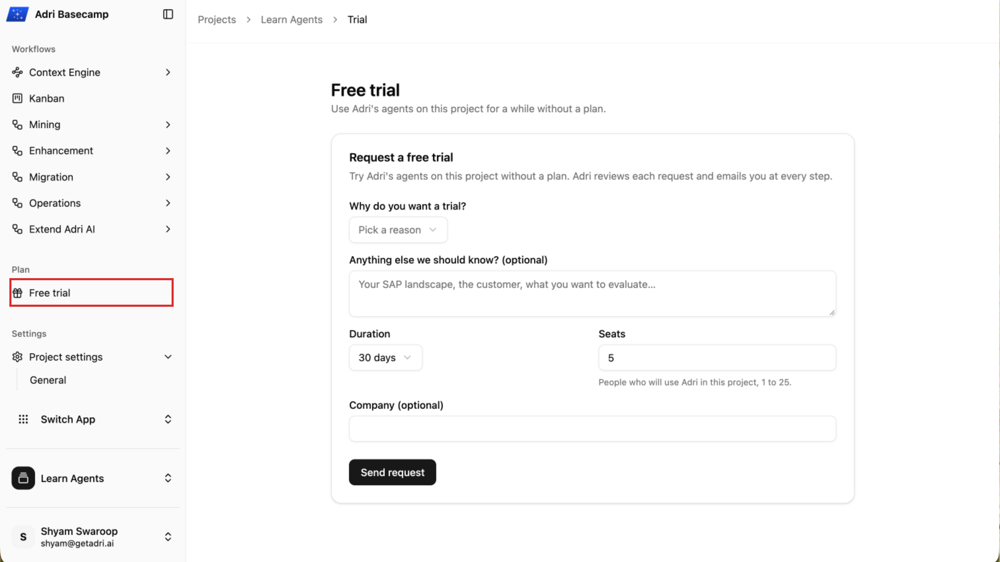
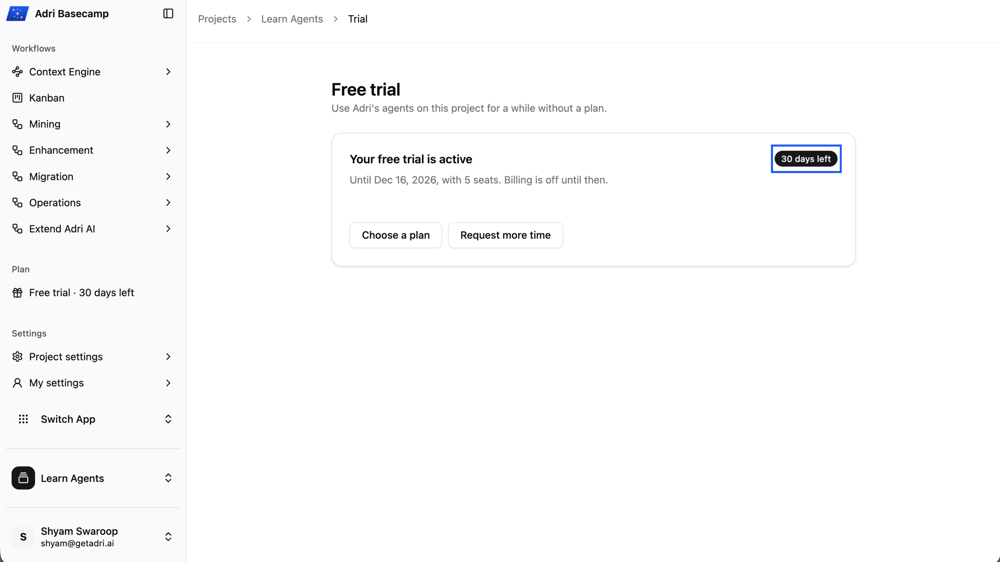
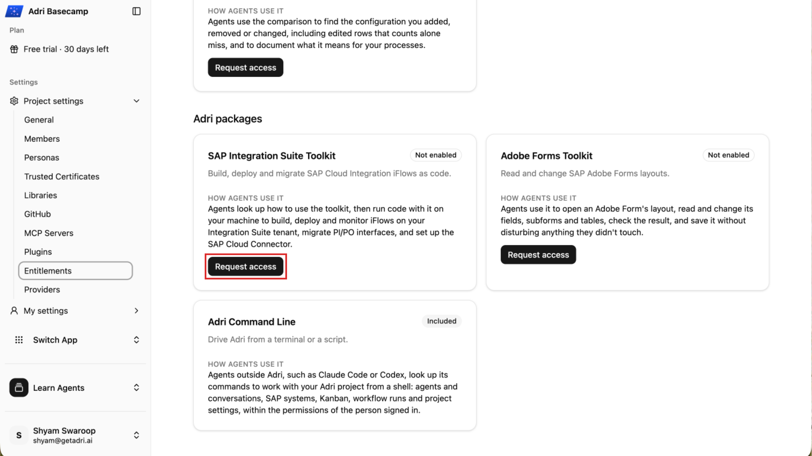
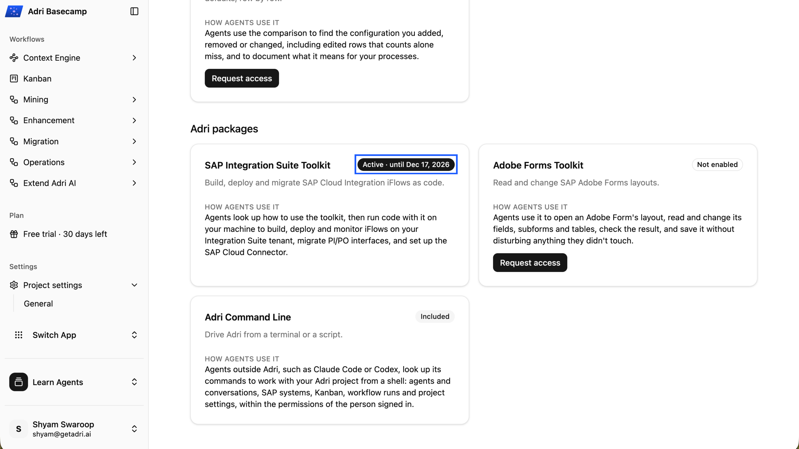

# Request SAP Integration Suite access

Request trials and entitlements directly from Adri Basecamp. You do not need to email the Adri team.

## Request a free trial

Select **Free trial**, complete the request, and select **Send request**.

The page shows the request status while it is pending. After approval, it shows the active period and days remaining.

## Request the toolkit entitlement

1. Open **Project settings > Entitlements**.
2. Scroll to **Adri packages**.
3. On **SAP Integration Suite Toolkit**, select **Request access**.
4. Add an optional note and select **Send request**.

After approval, the card displays **Active** and the entitlement end date.

:::info Request resolution
The Adri team resolves trial and entitlement requests within 24 hours. You can track or withdraw a pending request from the same page.
:::

Next, [add the Integration Suite Toolkit to your workspace](./add-toolkit.md).
