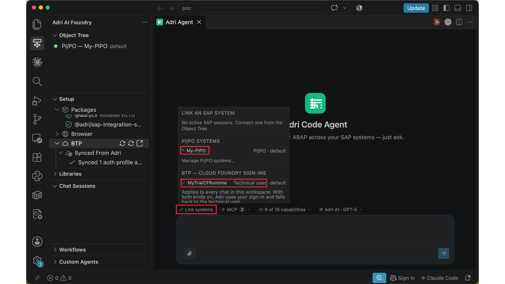
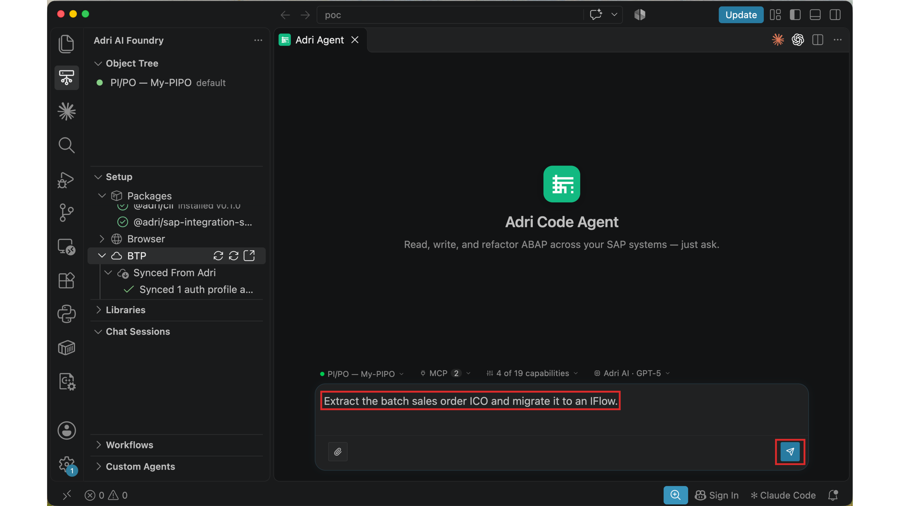

# Migrate a PI/PO interface

Before starting, complete the [PI/PO connection](../../pi-po/set-up/connect-pi-po.md), [Integration Suite Toolkit](../set-up/add-toolkit.md), and [Cloud Foundry connection](../set-up/connect-cloud-foundry.md).

1. Connect the PI/PO system from the **Object Tree**.
2. Create or open an **Adri Code Agent** session.
3. Select **Link systems**.
4. Enable the source PI/PO system and the target Cloud Foundry sign-in.
5. Select **Link systems**.

Describe the source interface and desired result. For example:

> Extract the batch sales order ICO and migrate it to an iFlow.

Review the linked systems, enabled capabilities, and model above the message box, then select **Send**.

For the complete journey from signup through this first request, follow [set up PI/PO to Integration Suite migration](../set-up/pi-po-to-integration-suite-migration.md).
