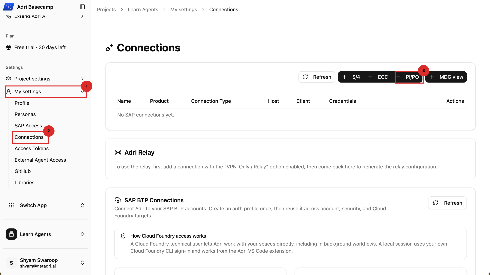
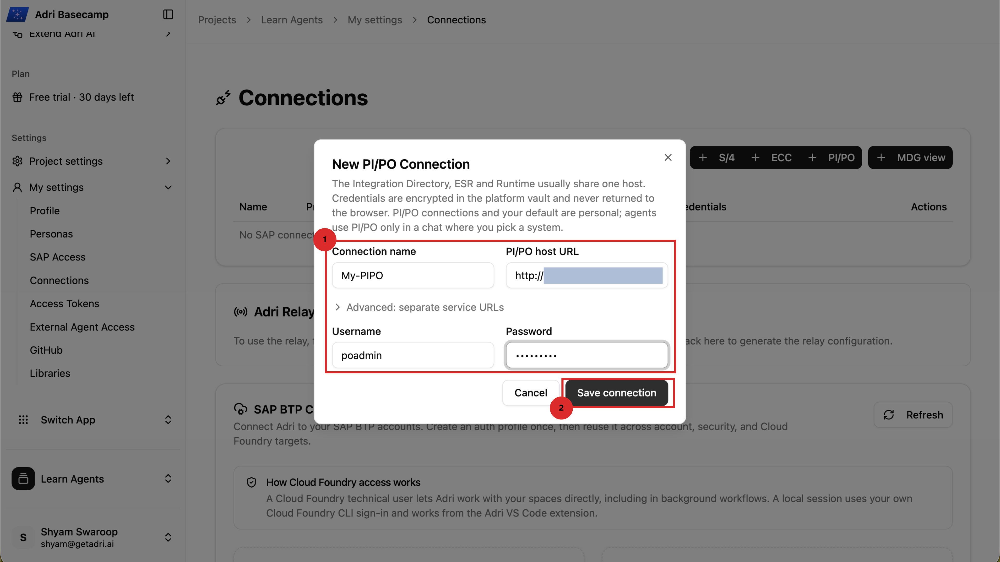
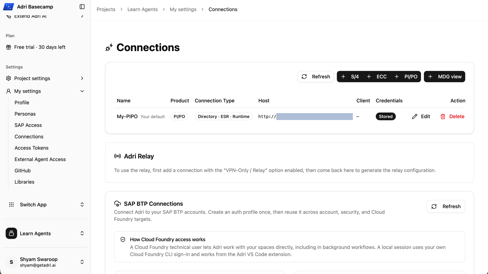
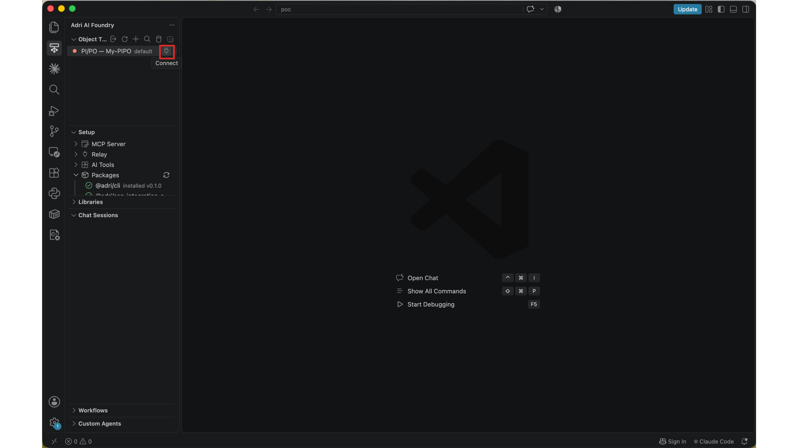

# Connect SAP PI/PO

Connect Adri AI to the Integration Directory, Enterprise Services Repository (ESR), and Runtime of your PI/PO system.

## Before you begin

You need the PI/PO host URL and the username and password Adri should use. If the Integration Directory, ESR, and Runtime are on different hosts, collect each service URL.

## Save the connection in Adri Basecamp

1. Open your project in Adri Basecamp.
2. Open **My settings > Connections**.
3. Select **+ PI/PO**.

4. Enter a connection name, PI/PO host URL, username, and password.
5. If the services use different URLs, expand **Advanced: separate service URLs** and enter them.
6. Select **Save connection**.

The saved connection appears in the list. Its credentials are encrypted in the platform vault and are not returned to the browser.

:::info Personal connection
PI/PO connections and your default PI/PO selection are personal. An agent can use the system only in a chat where you explicitly link it.
:::

## Connect from VS Code

1. [Install Adri AI Foundry for VS Code](../../vs-code-extension/install-vs-code-extension.md) and [sign in to Adri AI](../../vs-code-extension/sign-in-adri-ai.md).
2. In the **Object Tree**, find the PI/PO connection.
3. Select the connect icon beside it.

When the status turns green, you can explore the PI/PO workspace and link the system to an agent chat.

Next, [explore PI/PO and work with an agent](../use/explore-and-develop.md).
