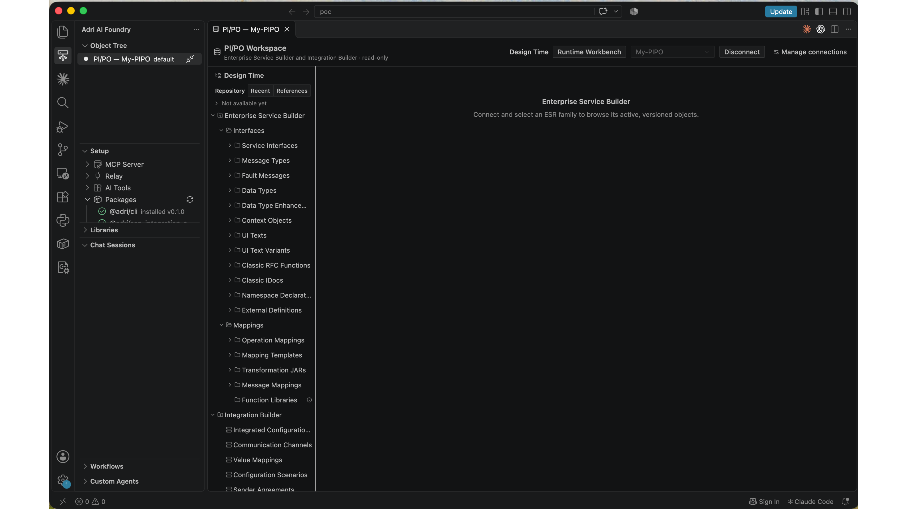

# Explore and develop SAP PI/PO integrations

After you [connect SAP PI/PO](../set-up/connect-pi-po.md), open the connected system from the **Object Tree**. Adri AI Foundry presents the PI/PO design-time and runtime workbenches in VS Code.

Use the workspace to browse objects such as service interfaces, message types, data types, mappings, integrated configurations, communication channels, and agreements that are available to your PI/PO user.

## Work with the Code Agent

1. Create or open an **Adri Code Agent** session.
2. Select **Link systems**.
3. Enable the PI/PO system and select **Link systems**.
4. Describe the outcome you want.

You can ask the agent to investigate or document an existing interface, help with a change, or develop a new PI/PO integration. Keep the first request specific: identify the interface or business outcome and state what you want the agent to produce.

To migrate an existing interface, follow [migrate a PI/PO interface to SAP Integration Suite](../../integration-suite/use/migrate-pi-po-interface.md).
