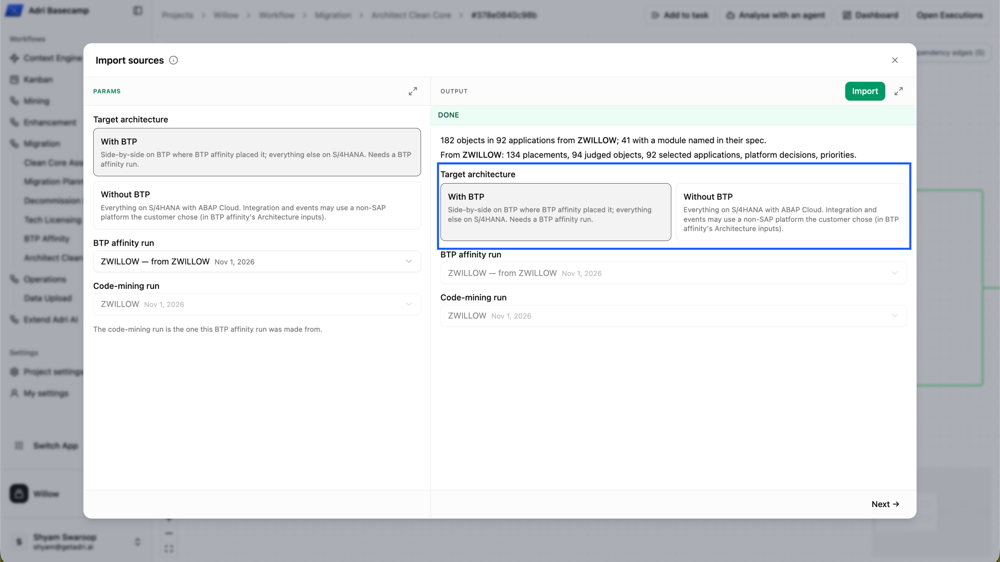

import SignUpAndProfileSetupComponent from '@site/src/components/SignUpAndProfileSetupComponent.mdx';
import CreateDemoProjectComponent from '@site/src/components/CreateDemoProjectComponent.mdx';
import ExploreBtpArchitectureComponent from '@site/src/components/ExploreBtpArchitectureComponent.mdx';

# Explore BTP architecture capabilities

Adri AI's **Architect Clean Core** pipeline designs a clean-core target architecture for a custom-code estate. It supports two target strategies: a side-by-side architecture that uses SAP BTP where appropriate, or an architecture that keeps the custom estate on S/4HANA using ABAP Cloud without requiring BTP.

The pipeline turns individual custom-code objects and their relationships into a reviewable application architecture. It shows how existing applications split, combine, or become new services; where each target application runs; and which dependencies remain between S/4HANA and side-by-side services.

## Explore BTP architecture in Adri AI

The Willow reference demo contains a completed **Architect Clean Core** run for an S/4HANA target architecture with BTP. Copy the reference project, then use the prepared result to explore its application mappings and estate diagram.

## Step 1: Sign up for Adri AI

<SignUpAndProfileSetupComponent />

## Step 2: Create a demo project and copy its data

<CreateDemoProjectComponent />

## Step 3: Explore the Architect Clean Core pipeline with BTP

<ExploreBtpArchitectureComponent />
