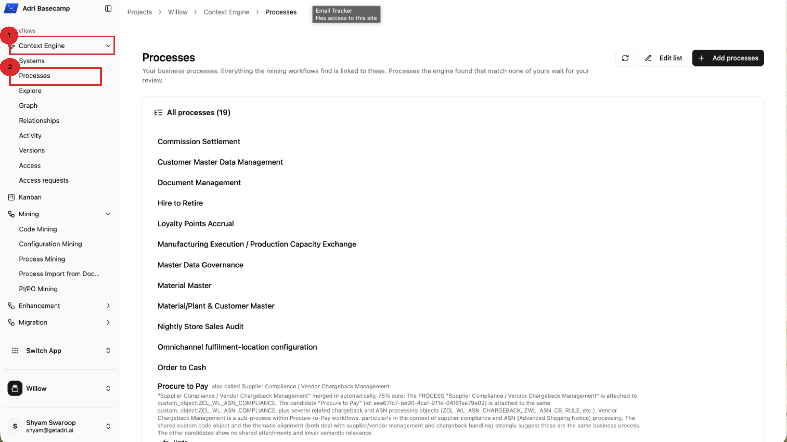
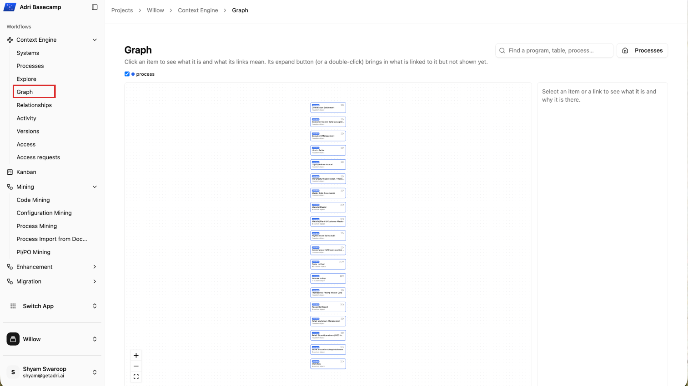
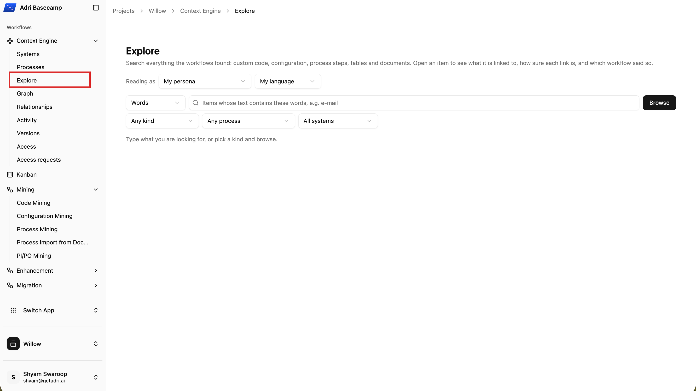
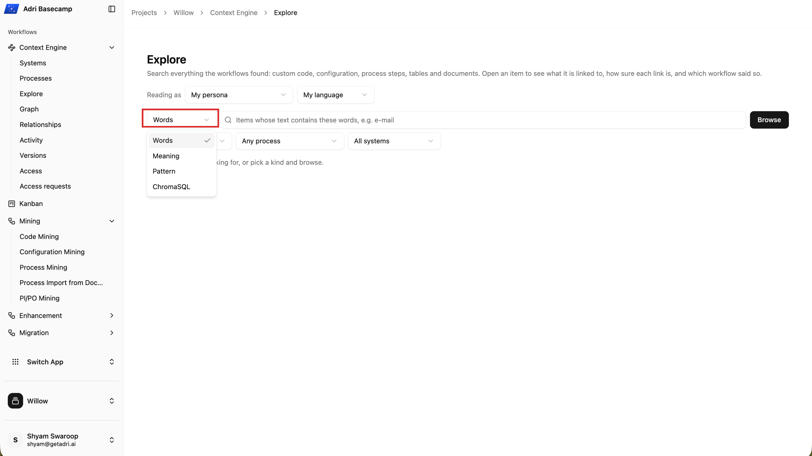
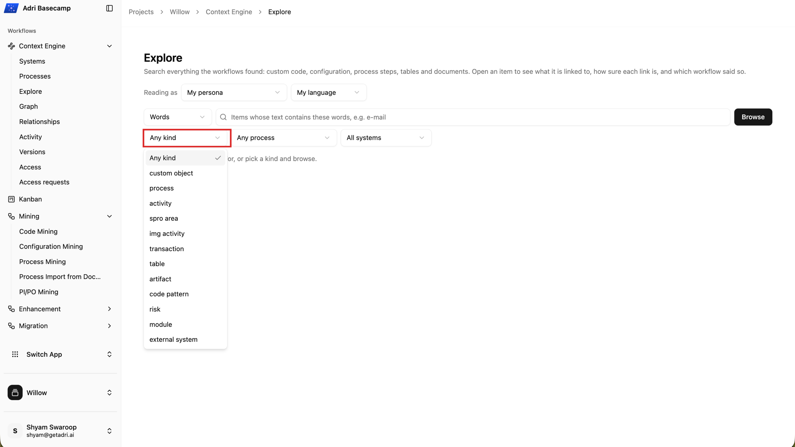
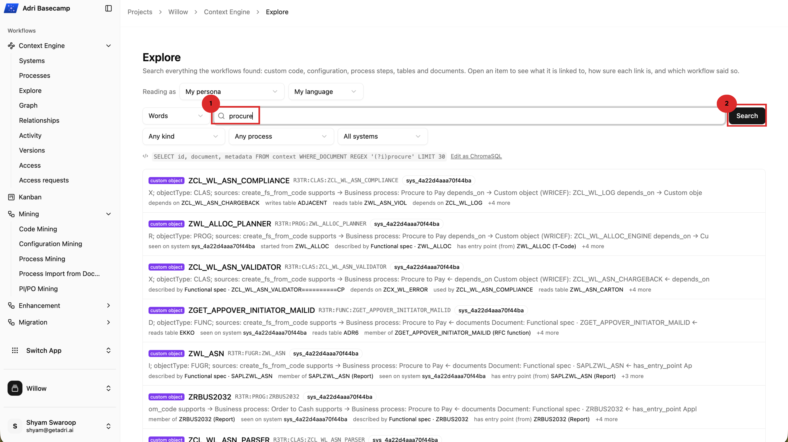

# Explore the context engine

import ContextEngineIntro from '@site/src/components/ContextEngineIntroComponent.mdx';
import SignUpAndProfileSetup from '@site/src/components/SignUpAndProfileSetupComponent.mdx';
import CreateDemoProject from '@site/src/components/CreateDemoProjectComponent.mdx';

<ContextEngineIntro />

## Explore the Context Engine in Adri AI

:::tip Already set up?
**If you have already signed up for Adri AI and copied the Willow reference project, skip directly to [Step 3](#step-3-explore-the-context-engine-in-multiple-ways).**
:::

## Step 1: Sign up for Adri AI

<SignUpAndProfileSetup />

## Step 2: Create a demo project and copy its data

<CreateDemoProject />

## Step 3: Explore the Context Engine in multiple ways

Open your demo project and expand **Context Engine** in the left navigation. You can explore its contents from a business-process view, as a relationship graph, or with targeted search.

### See processes in your systems at a glance

Select **Processes** to browse the business processes discovered or copied into the project. Open a process to inspect the SAP objects and evidence connected to it.

### Visualize using a graph

Select **Graph** to see processes and their relationships as a connected map. Search for an item, select a node for details, and expand it to bring linked items into view.

Watch this walkthrough to learn how to use the different features of the Context Engine graph.

  <iframe
    src="https://www.youtube-nocookie.com/embed/0Cixp06sedI"
    title="How to use the Context Engine graph features"
    loading="lazy"
    allow="accelerometer; autoplay; clipboard-write; encrypted-media; gyroscope; picture-in-picture; web-share"
    allowFullScreen
    style={{position: 'absolute', top: 0, left: 0, width: '100%', height: '100%', border: 0}}
  />

### Explore using advanced search features

Select **Explore** to search everything found by the workflows.

You can search using words, meaning, a pattern, or ChromaSQL.

Filter the results by item kind, business process, or source system.

Enter a term and select **Search**. The results show matching items together with their types, identifiers, systems, and important relationships.

**Done when:** You can browse the process list, open the graph, and find Context Engine items with search and filters.
