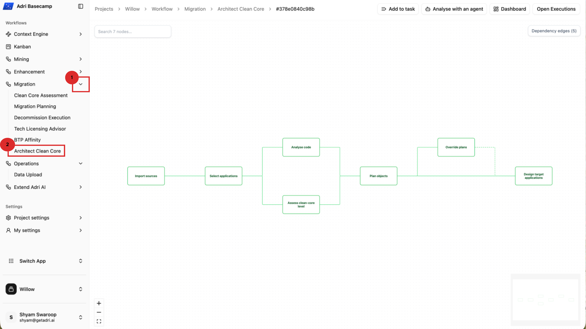
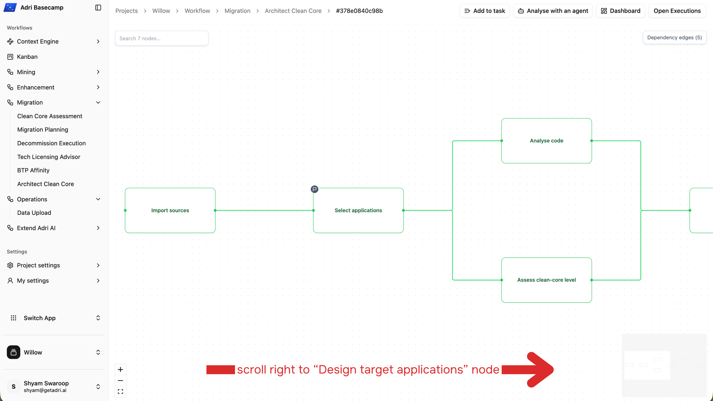
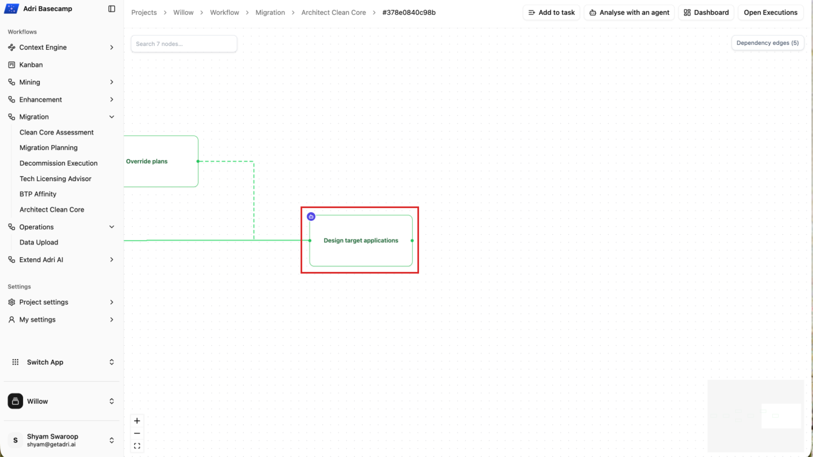
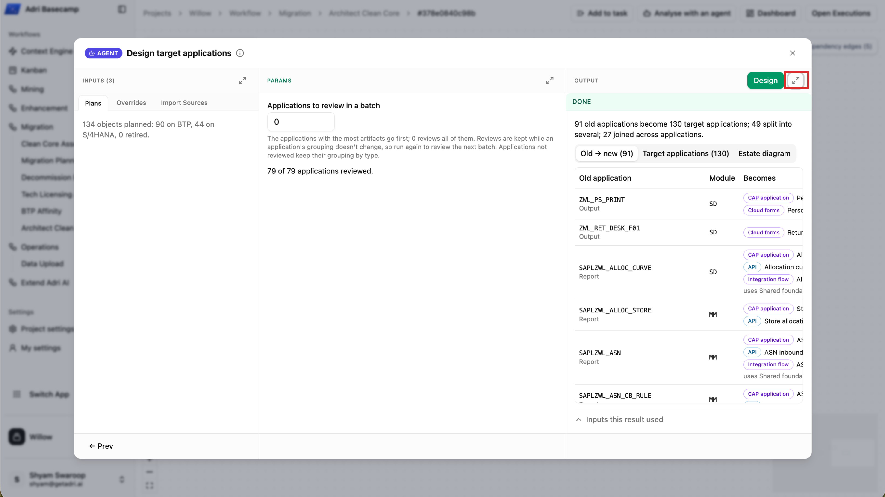
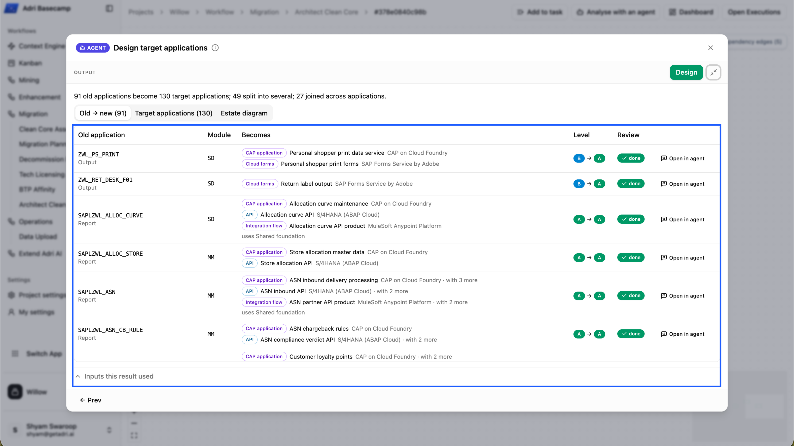
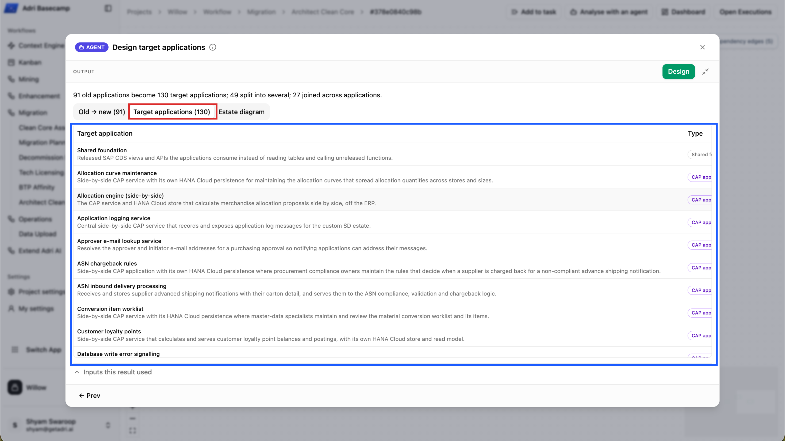
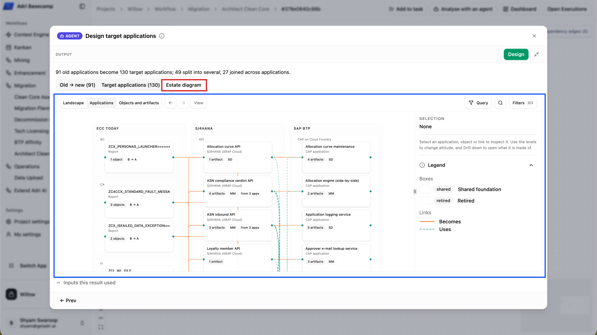
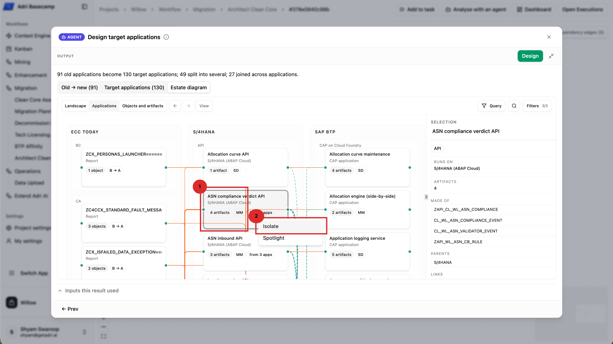
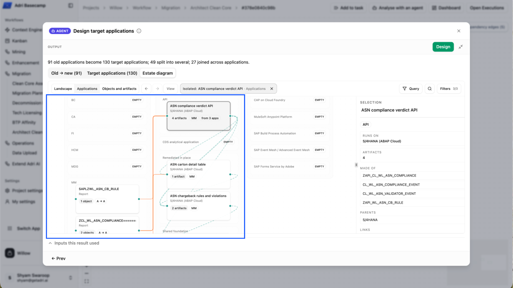

1. In your demo project, expand **Migration** and select **Architect Clean Core**.

2. Review the pipeline from **Import sources** through **Design target applications**. To inspect a node that is outside the current view, pan across the canvas or use the minimap in the lower-right corner.

The canvas supports zooming with **Ctrl + mouse wheel** on Windows and Linux, or **Command + mouse wheel** on macOS.

3. Move to the right-hand end of the pipeline and open **Design target applications**.

4. Expand the node output to use the available space.

5. Start with **Old → new**. This view shows how each current application is transformed into one or more target applications, including its module, proposed application types, target technologies, clean-core level, and review status.

6. Select **Target applications** to inspect the proposed target estate directly. Each row explains an application's responsibility and identifies its target type.

7. Select **Estate diagram** to explore the architecture visually. The diagram places the current estate, S/4HANA applications, and side-by-side BTP applications in separate areas. Solid links show what an existing application **becomes**; dashed links show what another application or service **uses**.

8. Select a node to inspect its platform, artifacts, parents, and links in the details panel. Right-click the node to open its context menu.

Choose between these views:

- **Isolate** keeps the selected node and all of its direct and indirect relationships visible, through the full relationship depth.
- **Spotlight** emphasizes the selected node while preserving the wider estate for context.

9. Choose **Isolate** when you need to trace one application's complete dependency path without unrelated nodes obscuring it. Close the isolation filter at the top of the diagram to return to the full estate.

**Done when:** You can compare the current and target applications, navigate the estate diagram, inspect a node's details, and isolate its complete relationship path.
