### Open the Code Mining workflow

In the Willow project, open **Mining**, select **Code Mining**, and open the prepared workflow run.

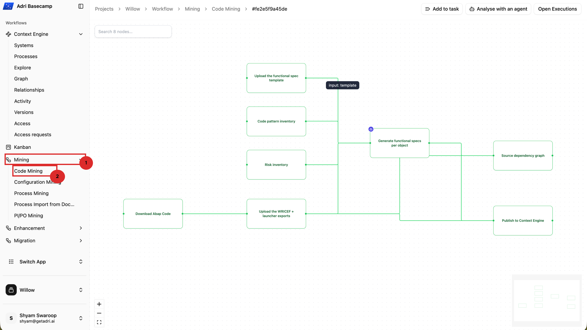

The workflow contains specialized agents for each stage of code analysis. Select **Generate functional specs per object** to inspect its completed output.

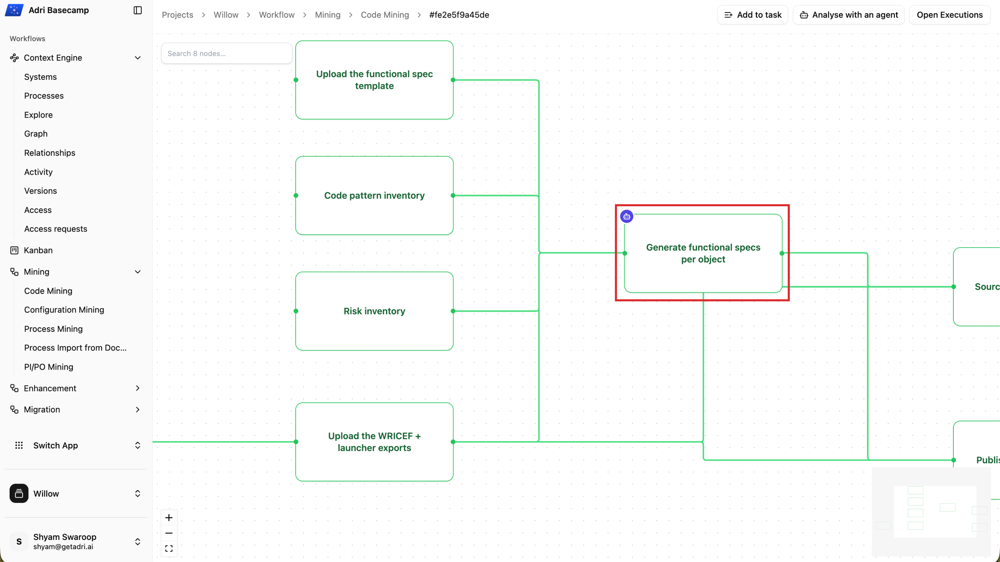

### Review generated functional specifications

The agent creates a functional specification for every successfully analyzed custom object. Open the agent details and expand the output.

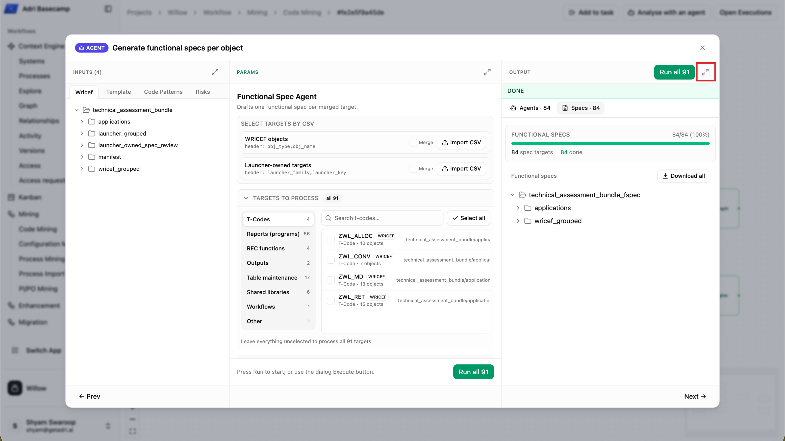

Navigate to **technical_assessment_bundle_fspec → applications → output**, then select a Markdown file to review the functional specification for that object.

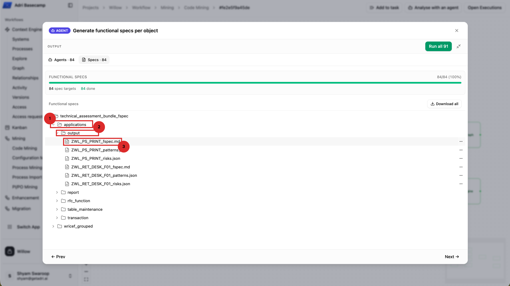

Each specification translates the source code into readable documentation. It identifies the object's purpose and explains its functional behavior, data usage, dependencies, processing flow, validations, and outputs.

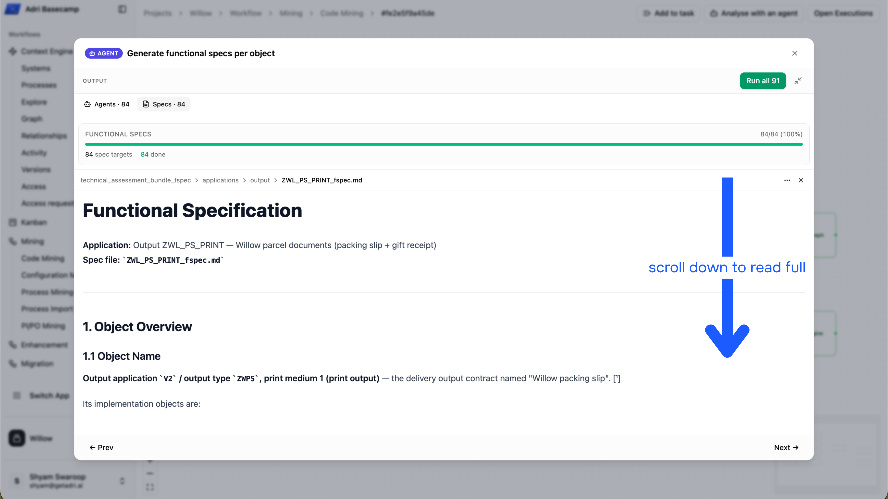

Scroll through the document to review the complete analysis.

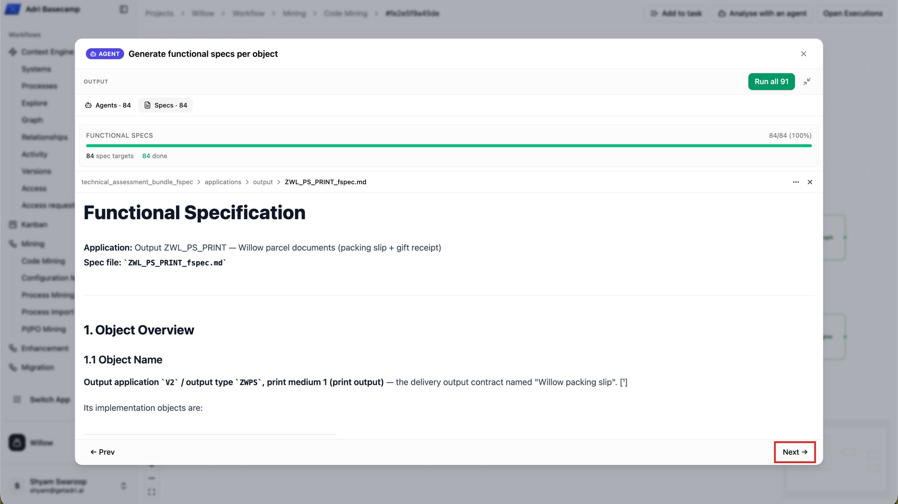

When you are ready to inspect the next deliverable, select **Next**.

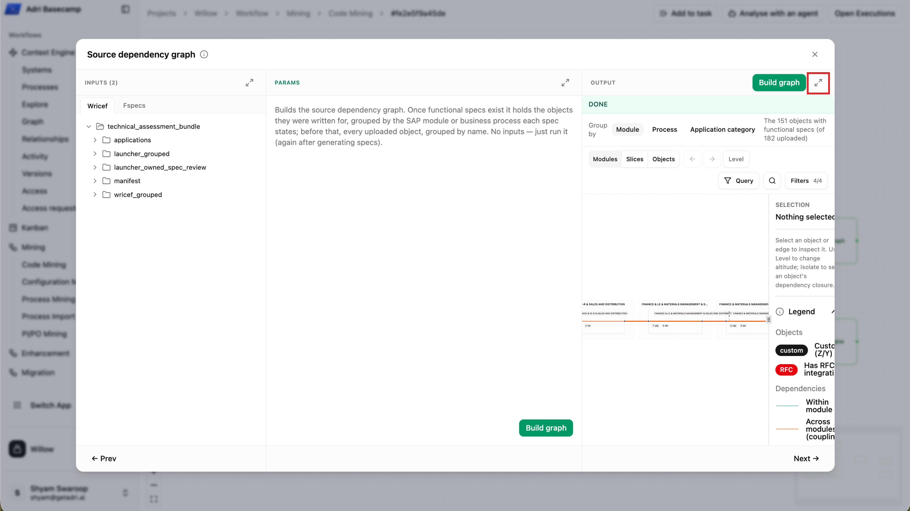

### Explore the source dependency graph

The source dependency graph turns relationships among custom objects into an interactive map. Open the graph output and expand it for more room to explore.

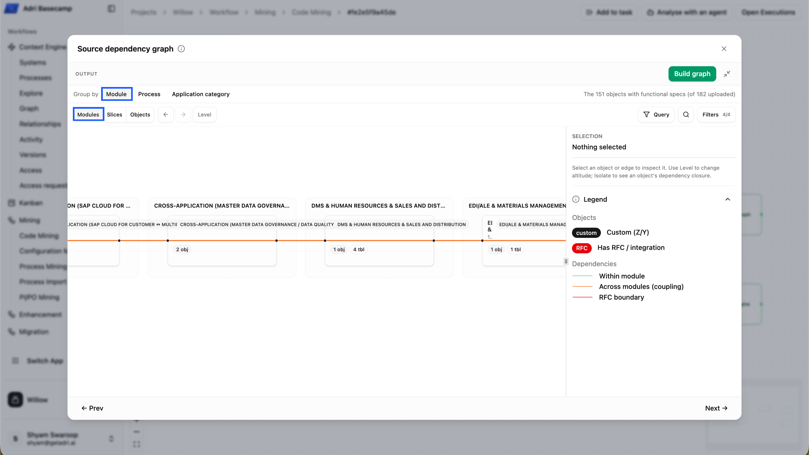

Start with **Module** to see how custom objects are distributed across SAP functional modules. Switch between **Modules**, **Slices**, and **Objects** to move from a portfolio-level view to individual objects.

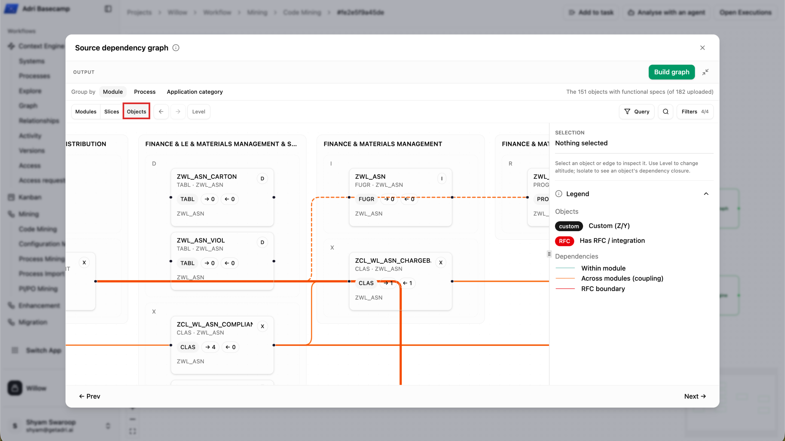

In **Objects**, select a card to inspect its type, incoming and outgoing dependencies, parent group, and related objects. Use **Isolate** to focus on that object's dependency closure.

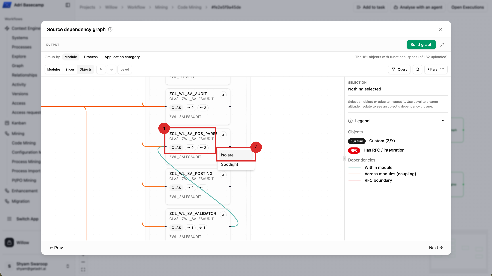

The isolated view keeps the selected object and the dependencies that explain its impact, making a dense landscape easier to analyze.

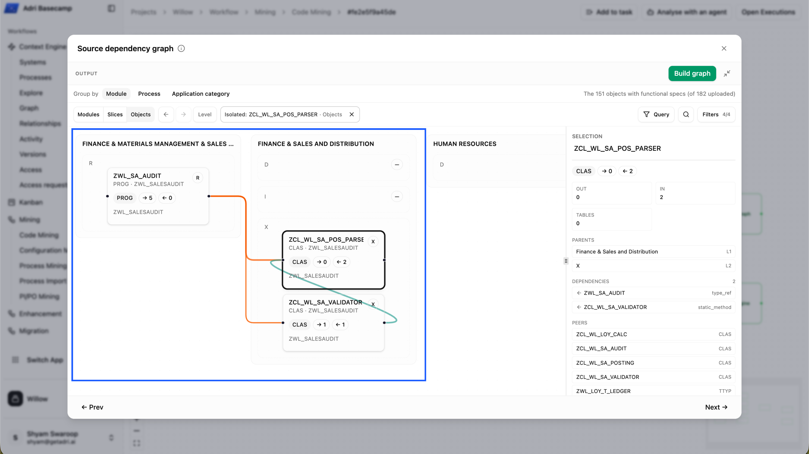

Choose **Process** to organize the same source-code inventory by the business processes associated with each object. This is a code-classification view within Code Mining; it is not process mining.

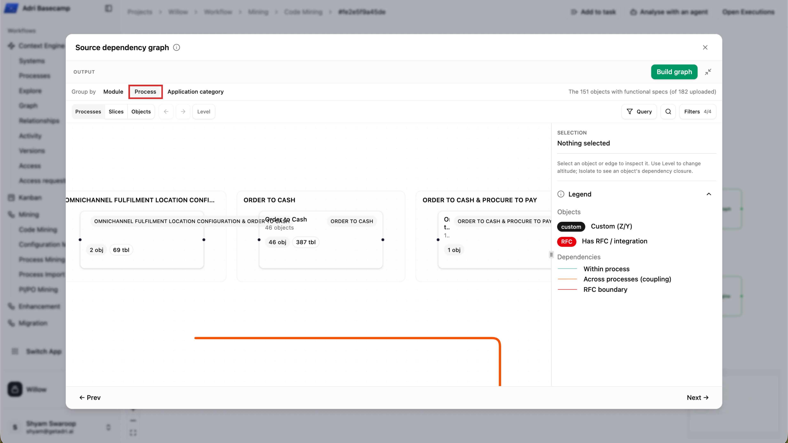

Switch to **Objects** to inspect the code-level dependencies within and across those process groups. The legend distinguishes dependencies within a group, coupling across groups, and RFC boundaries.

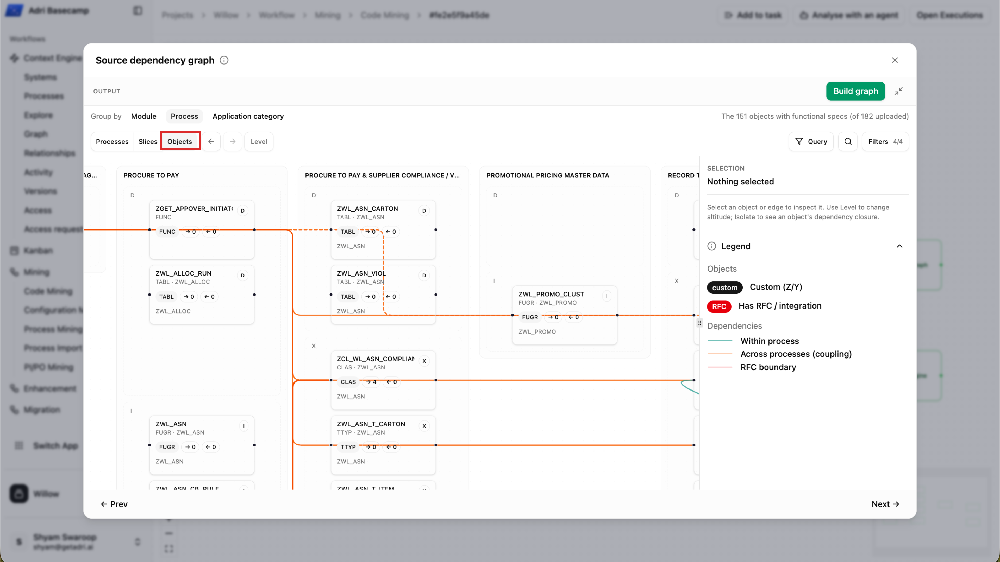

Choose **Application category** to group custom code by its technical usage pattern, such as output and report combinations, transaction-code outputs, or RFC functions and reports.

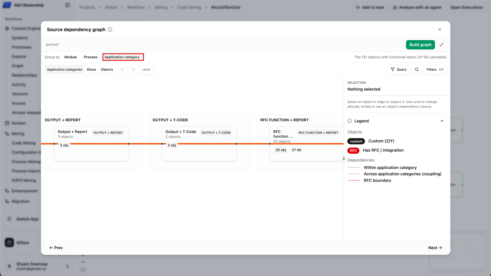

Open **Objects** to see the individual custom objects behind each category and trace coupling across categories.

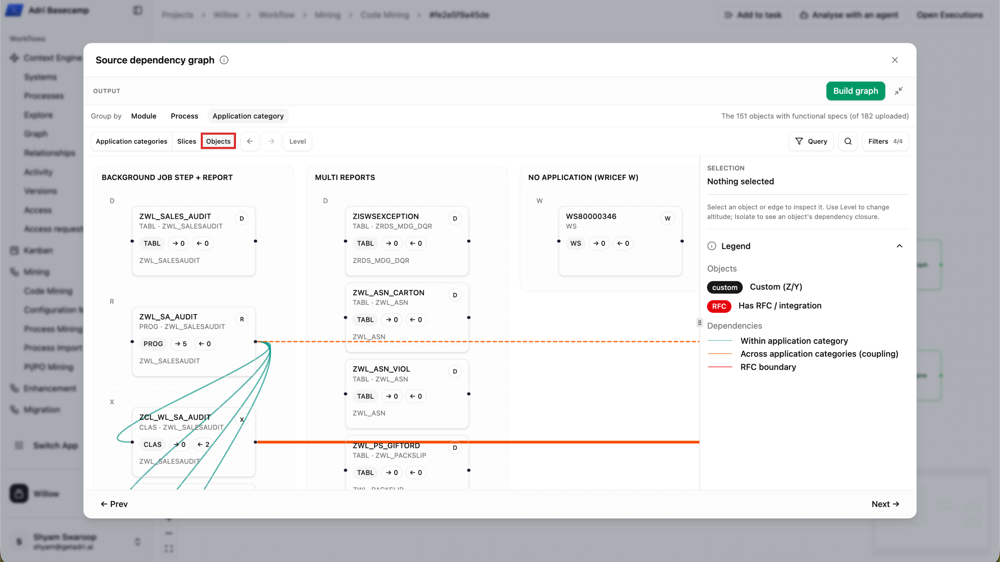

Together, the generated functional specifications and dependency graph give you both object-level documentation and a landscape-wide view of how your custom code is organized and connected.
